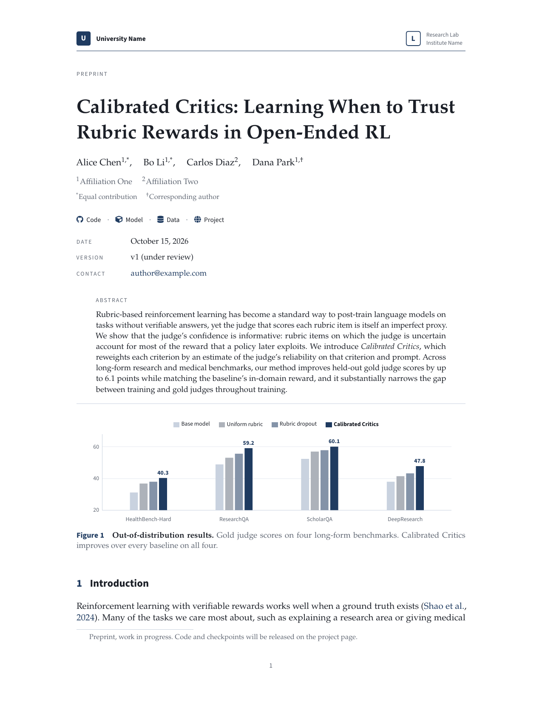

# InkPaper


[](https://www.overleaf.com/docs?snip_uri=https://github.com/codedog246/inkpaper/archive/refs/heads/rigorous.zip&snip_name=InkPaper)

A polished, institution-neutral, single-column LaTeX template for machine
learning and AI preprints.

InkPaper combines restrained typography with reusable components inspired by
modern research-lab technical reports, without embedding any organization's
branding.

<p align="center">
  
</p>

The Overleaf badge imports the repository as a new project; set `main.tex` as
the main document and the compiler to pdfLaTeX (the zip also contains
`spec.tex`, the callout specimen).

## Features

- Three low-saturation palettes: `navy`, `teal`, and `slate`
- Rigorous, open, and panel-style title layouts
- Left-aligned or centered title blocks
- Optional institution and lab logos, with a placeholder-logo helper
- Metadata links for code, models, data, and project pages
- Colour-coded, numbered takeaway, discussion, guidance, and observation
  boxes whose colours are derived from the palette accent
- Formal finding statements, highlighted table rows, side captions, and
  appendix prompt blocks, including a verbatim variant for raw prompts
- pgfplots presets that carry the page's fonts and colours
- `numbers` and `nonatbib` options for numeric citations and biblatex
- Styled appendix title and automatic appendix contents
- Standard `pdflatex` workflow suitable for arXiv

## Quick start

```latex
\documentclass[
  palette=navy,
  titlestyle=rigorous,
  titlealign=left
]{inkpaper}

\title{Your Paper Title}
\author{First Author, Second Author}
\affiliations{Your University or Research Organization}
\abstract{Your abstract.}

\begin{document}
\maketitle
\section{Introduction}
...
\end{document}
```

`\abstract{...}` is a command that goes in the preamble; `\maketitle` typesets
it inside the title block. The classic `\begin{abstract}...\end{abstract}`
form also works, either before `\begin{document}`, before `\maketitle`, or
after `\maketitle` (where it is typeset in place; see the command reference
for the two style-specific caveats).

Compile the included example with:

```bash
make
```

The result is `main.pdf`. The committed `main.pdf` and `preview.png` are the
showcase output: if you change `main.tex` or `inkpaper.cls`, run `make` and
`make preview`, then commit the regenerated `main.pdf` and `preview.png` (CI
rebuilds the example and fails if the committed PDF is stale).

`make spec` builds the one-page callout specimen (`spec-navy.pdf`,
`spec-teal.pdf`, `spec-slate.pdf`), which shows every box in each palette and
is the visual regression page for the callout family. `make palette` prints
the generated callout colours and their contrast report. `make preview`
regenerates `preview.png`, the screenshot shown above, from page 1 of
`main.pdf`.

To prepare an arXiv submission, run

```bash
make arxiv
```

and upload the resulting `main-arxiv.tar.gz`; see
[Submitting to arXiv](#submitting-to-arxiv).

## Class options

| Option | Values | Default | Notes |
| --- | --- | --- | --- |
| `palette` | `navy`, `teal`, `slate` | `navy` | Sets `ipAccent`, `ipPanel`, `ipRule`, `ipLink` and the generated callout colours |
| `titlestyle` | `rigorous`, `open`, `panel` | `rigorous` | `rigorous`: serif title, centred abstract, closing hairline; `open`: tinted abstract box; `panel`: title, abstract, links and metadata in one tinted box |
| `titlealign` | `left`, `center` | `left` | In `center` mode the metadata rows are set on one line; the panel footer (metadata and logo) is stacked and centred |
| `numbers` | flag | off | Numeric `[1]` citations; natbib is loaded with `[numbers,sort&compress]` |
| `nonatbib` | flag | off | Skip natbib so biblatex can be loaded |
| anything else | e.g. `a4paper`, `11pt`, `draft` | – | Forwarded to `article`: `a4paper`/`letterpaper` set the paper size (default US Letter); `11pt`/`12pt` scale the headings and title with the body. `twocolumn` stops with a class error, and so does a misspelt `palette`/`titlestyle`/`titlealign` value |

The example in the repository uses `palette=navy, titlestyle=rigorous,
titlealign=left`; the comment on its first line lists the other looks
(`titlestyle=open`, `titlealign=center`, `palette=teal|slate`).

## Command reference

All of these go in the preamble unless noted. Everything except `\title` and
`\author` is optional.

| Command | Purpose | Default |
| --- | --- | --- |
| `\title{...}`, `\author{...}` | Standard LaTeX. `\author{A \and B}` works; `\thanks{...}` inside `\author` works as in `article` (symbol marks, text printed above the first-page note in the rigorous and open styles, below it in the panel style; body footnotes restart at 1). `\authornotes` remains available for the compact inline style used in `main.tex` | required |
| `\shorttitle{...}` | Running head, top-left of every page after the first, set in `ipGray`; falls back to `\title` (line breaks flattened) if omitted | `\title` |
| `\papertag{...}` | Tracked-caps label above the title and top-right running head; `\papertag{}` removes the tag line | `Preprint` |
| `\affiliations{...}` | Line under the authors | empty |
| `\authornotes{...}` | Smaller line for equal-contribution / corresponding marks | empty |
| `\abstract{...}` | Abstract text, typeset inside the title block by `\maketitle`. `\begin{abstract}...\end{abstract}` also works, before `\begin{document}`, before `\maketitle`, or after it (then typeset in place). After `\maketitle`, `panel` style falls back to the rigorous layout and `rigorous` style sets the abstract below the closing rule, so prefer giving it before `\maketitle` | empty |
| `\date{...}` | Adds a `Date` metadata row. Unlike `article`, nothing is printed if you omit it (no `\today` default); `\date{}` prints nothing | none |
| `\correspondence{...}` | Adds a `Contact` metadata row; an empty value prints nothing | none |
| `\metadata{Label}{Value}` | Any extra metadata row, e.g. `\metadata{Version}{v1 (under review)}`. An empty value prints nothing; a label wider than the 6.2em column is set at natural width plus a 0.8em gap | – |
| `\code{url}`, `\model{url}`, `\data{url}`, `\project{url}` | Icon links under the title | – |
| `\linkitem{\faIcon}{Label}{url}` | Custom icon link using any `fontawesome5` icon; an empty first argument gives a word without an icon | – |
| `\leftlogo{...}`, `\rightlogo{...}` | First-page header logos: `\placeholderlogo{U}{University Name}` or `\includegraphics[height=16pt]{logo/university.pdf}`. Setting either switches the first page to a header with an accent rule | empty |
| `\placeholderlogo[fill\|outline]{Mark}{Text\\Text}` | A 16pt badge with the mark plus one or two lines of text; needs no image files or extra packages. `outline` draws the badge as an accent outline with gray text | `fill` |
| `\panellogo{...}` | Logo inside the panel (only with `titlestyle=panel`). If set, `\leftlogo` and `\rightlogo` are suppressed | empty |
| `\firstpagenote{...}` | Unnumbered footnote on page 1 | empty |

`\maketitle` also writes `\title` and `\author` into the PDF Title and Author
fields (line breaks, `\and`, `\textsuperscript` marks and `\thanks` are
stripped from the metadata strings only).

In the body:

| Command / environment | Purpose |
| --- | --- |
| `\captitle{Lead-in.}` | Bold dark lead-in inside a `\caption` |
| `\sidefigure[0.64]<t>{<figure body>}{\caption{...}\label{...}}` | Figure with the caption beside it; the optional ratio is the figure's share of `\linewidth`, the optional placement defaults to `t` (pass `<h>`, `<b>` or `<htbp>` as for a normal figure; a bare specifier in the bracket slot, `\sidefigure[h]{...}{...}`, is accepted too) |
| `\oursrow` | Put at the start of a table row to shade it: `\oursrow Ours & ... \\` (write the table preamble without `@{}` at the outer edges) |
| `\begin{threeparttable} ... \end{threeparttable}` | Around `\caption` + `tabular` inside a `table`: the caption is set to the width of the tabular (`threeparttable` is preloaded) |
| `\begin{takeaway}[label=...]`, `discussion`, `practicalguidance`, `observation` | Numbered, colour-coded callouts; see [The callout family](#the-callout-family) |
| `\begin{finding}[Title]`, `\begin{keybox}[Title]` | Formal statement on an accent tint between two hairlines; titles default to `Main finding` / `Key takeaway` |
| `\begin{promptbox}[Title] ... \end{promptbox}` | Breakable monospace box for prompts; the title defaults to `Prompt`; the body is ordinary LaTeX (escape `{ } _ # % &`) |
| `\begin{promptbox*}[Title] ... \end{promptbox*}` | Same frame, verbatim body: `{ } _ # % & \` are literal, source line breaks are kept, and common smart punctuation and accented letters are mapped |
| `\paragraph{Title}` | Run-in head; the class appends the period for you and skips it if the title already ends in `.`, `:`, `?` or `!`, so both `\paragraph{Setup}` and `\paragraph{Setup.}` render as **Setup.** |
| `\tableofcontents` | Styled like the appendix contents (sans, accent numbers, dotted leaders); References gets a TOC entry and a PDF bookmark |
| `\beginappendix` | `\clearpage\appendix`, an `Appendix` heading and a local table of contents (needs two LaTeX runs; `latexmk` handles it) |
| `\figurewidth`, `\figureheight` | Lengths for plots: `\textwidth` and `0.32\textwidth`, set at `\begin{document}` |

**Colours** you can reuse in TikZ or pgfplots: `ipAccent`, `ipPanel`,
`ipRule` and `ipLink` (palette-dependent; `ipLink` is the hyperlink colour,
steel blue in `slate` and equal to the accent otherwise), the neutrals
`ipInk`, `ipGray`, `ipFaint`, and the generated callout set `ipTakeaway`,
`ipDiscussion`, `ipGuidance`, `ipObservation` (each with a `...Tint`
companion), `ipOurs` and `ipFindingTint`.

**Plots.** If the document loads `pgfplots`, two presets carry the page's
fonts and colours: `\begin{axis}[inkpaper, ...]` for line plots (accent, then
faint dashed, then two lighter accent series) and `\begin{axis}[inkpaper
bars, ...]` for `ybar` charts on the light-to-accent ramp with a top legend
(add `nodes near coords` to a series for accent value labels). Both default
to `width=\linewidth, height=\figureheight`. Nothing is loaded or defined
unless the document loads `pgfplots`; `main.tex` uses the `inkpaper` preset
for its ablation figure.

**Spacing and floats.** The class sets `\frenchspacing` (a single space after
sentence-ending punctuation); put `\nonfrenchspacing` in the preamble to
restore the double space. The float parameters let a page be mostly float
before LaTeX pushes a float to the next page (`\topfraction` 0.85,
`\floatpagefraction` 0.75); the vertical spacing around floats is `article`'s.

**Bibliography.** `natbib` is preloaded with round author-year citations, so
use `\bibliographystyle{plainnat}` (or `abbrvnat`, `unsrtnat`) with
`\citep`/`\citet`. `\bibliographystyle{plain}` stops with
`Package natbib Error: Bibliography not compatible with author-year citations`.
`\documentclass[numbers]{inkpaper}` gives `[1]`-style citations (then
`plainnat`/`unsrtnat` print numbers). References are set in `\small`.

See `main.tex` for a complete example using most of the above.

## Packages the class already loads

`geometry`, `hyperref`, `natbib` (unless `nonatbib`), `enumitem`,
`xcolor[table]`, `caption`, `threeparttable`, `tcolorbox[most]` (which brings
TikZ and `listings`), `microtype`, `amsmath`, `amssymb`, `amsthm`,
`newpxtext`/`newpxmath`, `sourcesanspro`, `zi4`, `fontawesome5`, `titlesec`,
`titletoc`, `fancyhdr`, `booktabs`, `graphicx`, `url`, `etoolbox`,
`kvoptions` and `iftex` are loaded by the class. `amssymb` and `amsthm` are
loaded before `newpxmath` on purpose; a later `\usepackage{amsthm}` is
harmless. Do **not** `\usepackage` any of these again *with options* (you
will get *Option clash for package ...*). Instead:

```latex
\documentclass[numbers]{inkpaper}        % numeric citations [1, 2] instead of (Author, 2024)
\documentclass[nonatbib]{inkpaper}       % skip natbib, then \usepackage[style=authoryear]{biblatex}
                                         % + \addbibresource{...} + \printbibliography
\geometry{margin=1in}                     % after \documentclass
\hypersetup{linkcolor=blue}
\PassOptionsToPackage{inline}{enumitem}   % must come BEFORE \documentclass
```

## Upgrading

`CHANGES.md` lists every change against the first `rigorous` branch with its
rationale and the review finding it answers; `CHANGELOG.md` is the short
release history.

### From the open/panel release (`main` branch)

An existing `main.tex` compiles unchanged, but the output differs in these
ways:

- The default `titlestyle` is now `rigorous`; pass `titlestyle=open` or
  `titlestyle=panel` explicitly to keep the previous title page.
- `keybox` is now the same box as `finding`: a short statement on a faint
  accent tint between two accent hairlines, with a small tracked-caps label
  on its own line (it was a tinted panel with an accent bar on the left and a bold
  accent title). Its default label is still "Key takeaway". For a coloured,
  numbered callout use `takeaway` instead.
- `\oursrow` still shades the row, now with `ipOurs`, a tint of the palette
  accent generated with the callout colours, instead of `ipPanel`. Write the
  table preamble without `@{}` at the outer edges (`lcccc`, not
  `@{}lcccc@{}`) so the tint ends exactly on the booktabs rules.
- `\code`, `\model`, `\data` and `\project` render as a small accent icon
  plus a regular-weight word, separated by middle dots instead of `\qquad`
  gaps. `\linkitem{}{Word}{url}` with an empty first argument gives a word
  without an icon.
- `promptbox` has a square 0.45pt frame and a white title row with a gray
  caps title (it had a rounded 0.6pt frame and a tinted title row with a bold
  accent title). `promptbox*` is new.
- The `Date`/`Contact`/`\metadata` labels are set in the gray tracked-caps
  label voice instead of bold accent sans; a label wider than the column is
  no longer overprinted by its value; `\date{}`, `\correspondence{}` and
  `\papertag{}` print nothing instead of an empty row or line.
- The first-page header is 32pt high instead of 26pt (a two-line logo no
  longer triggers the fancyhdr `headheight` warning). The text area is
  unchanged, so the logos and the first-page rule sit 6pt higher; that rule
  is 0.5pt instead of 0.8pt. The running head is set in `ipGray` instead of
  `ipFaint` and falls back to `\title` when `\shorttitle` is not given.
- `\begin{abstract}...\end{abstract}` works (it used to lose the first
  character of the text), `\thanks{...}` inside `\author` prints its note (it
  was dropped), and `\author{A \and B}` no longer fails. The open abstract box
  and the panel can break across pages; the panel's footer row is omitted
  when there is no metadata and no `\panellogo`, and is a centred stack in
  `titlealign=center`.
- New class options `numbers` and `nonatbib`; `a4paper`/`letterpaper` and
  `11pt`/`12pt` are honoured (the paper size was fixed to letter, and the
  headings and title now scale with the body size). `twocolumn` and misspelt
  `palette`/`titlestyle`/`titlealign` values stop with a class error instead
  of being ignored; XeLaTeX and LuaLaTeX stop with a class error.
- Body typography: `\frenchspacing` (one space after a sentence;
  `\nonfrenchspacing` restores the old spacing); References in `\small` with
  a tighter entry gap, a TOC entry and a PDF bookmark; the footnote rule's
  height is correctly accounted (a full page with footnotes was 4.4pt
  overfull); a one-line table caption is centred over its table;
  `\paragraph{Title.}` no longer renders a double period; enumerate labels
  are flush with the margin and the items indented by a two-digit label;
  relaxed float parameters; `\sidefigure` takes an optional `<placement>`;
  hyperlinks use `ipLink` (steel blue in `slate`, the accent elsewhere as
  before). The measure, `\parskip`, `\parindent` and the type scale are
  unchanged, but the line breaks and pagination of an existing document can
  shift.

### From the first `rigorous` branch

- `finding` and `keybox` were an unboxed statement between two gray
  hairlines with a run-in bold title, both defaulting to "Main finding.". They
  are now the tinted finding box with a caps label on its own line; `keybox`
  defaults to "Key takeaway" again, and `[]` suppresses the label.
- The four numbered boxes take their colours from the palette accent (one set
  per palette) instead of four fixed hues; square corners, a stroked 0.45pt
  frame, a 10pt inset and a caps label on the bar; a box that breaks across
  pages repeats its bar with "(continued)"; `\cref` works.
- `\oursrow` shades the row again (it was a no-op).
- `\code`, `\model`, `\data` and `\project` show their icon again, with a
  regular-weight word in ink (the branch set a bold accent word, no icon).
- Rigorous title page: the tag, the metadata keys and the `Abstract` heading
  share the gray tracked-caps label voice; the authors are regular weight;
  the hairline above the abstract is gone and the closing hairline is drawn
  even without an abstract; `promptbox` has a gray caps title.
- Everything in the previous list from the `\metadata` labels onward also
  applies.

## Components

```latex
\code{https://github.com/your-org/project}
\model{https://huggingface.co/your-org/model}
\data{https://huggingface.co/datasets/your-org/data}
\project{https://project.example.com}
\linkitem{\faFilePdf}{Slides}{https://example.com/slides}

\begin{takeaway}[label=tk:main]
\textbf{Primary conclusion.} Supporting evidence and scope.
\end{takeaway}

\begin{discussion}
\textbf{Connection to prior work.} A focused interpretation.
\end{discussion}

\begin{practicalguidance}
\textbf{Recommended practice.} Concrete guidance for practitioners.
\end{practicalguidance}

\begin{observation}
\textbf{Empirical pattern.} What was seen and under which conditions.
\end{observation}

\begin{finding}[Main finding]
The main finding in one or two sentences, consistent with Takeaway~\ref{tk:main}.
\end{finding}

\begin{keybox}[Key takeaway]   % legacy name; renders exactly like finding
...
\end{keybox}

\begin{promptbox}[Judge prompt]
Your prompt text.
\end{promptbox}

% Verbatim variant: paste raw prompts, JSON or templates without escaping.
% { } _ # % & \ are literal and source line breaks are kept.
\begin{promptbox*}[Judge prompt]
Return JSON: {"verdict": "YES" | "NO"}  # use max_tokens=64
\end{promptbox*}

% In a tabular: tint the row of your own method (palette-aware), bold the best values
\oursrow \textbf{Ours} & \textbf{40.3} & \textbf{59.2} \\
```

`promptbox*` wraps long lines at spaces only; a single token wider than the
text block (e.g. a long URL or minified JSON without spaces) will stick out
of the frame. Common smart punctuation and accented letters are handled; add
further characters to the `literate` list in `inkpaper.cls` if needed.

### The callout family

Every callout shares one grammar: square corners, 0.45pt rules, a 10pt
inset, `\small` body text and one label voice (sans tracked caps, the same
voice as the PREPRINT tag and the running head). What the colour code means:

| Box | Colour | Use it for |
| --- | --- | --- |
| `takeaway` | palette accent hue, darkest bar | the conclusion a skimming reader must not miss |
| `discussion` | accent hue + 80 deg (plum in navy and slate, violet in teal) | interpretation, relation to prior work, caveats |
| `practicalguidance` | accent hue - 62 deg (teal in navy and slate, green in teal) | what a practitioner should do |
| `observation` | neutral gray, lightest bar | an empirical pattern, stated without interpretation |
| `finding` / `keybox` | accent hairlines on an accent tint, no bar | the formal result, one rank below the coloured boxes |
| `promptbox` / `promptbox*` | gray frame, white title row | quoted material (prompts, rubrics) |

The four coloured bars are generated per palette by `semantic_palette.py`
(OKLCH): one chroma per palette, hues anchored on the accent, and a small
lightness ladder (Takeaway darkest, Observation lightest) so a grayscale print
keeps their order; Takeaway and Discussion are close in gray, and under
red-green colour-vision deficiency Discussion and Guidance can converge, so
the printed label, not the hue alone, identifies the role. Every bar carries
white text at 5:1 or better.
Run `make palette` to see the contrast report and the generated colour blocks;
after changing the generator, paste its `--tex` output into the colours
section of `inkpaper.cls` and rebuild `make spec`.

Usage guidance:

- Keep at least one paragraph of running text between two callouts, and no
  more than three coloured callouts on a page; the bars are the loudest
  objects on the page by design.
- Labels are set in caps automatically; pass plain text (`[Key result]`),
  without a trailing period. An empty optional argument `[]` on `finding`
  or `keybox` suppresses the label line.
- The four numbered boxes take tcolorbox keys in their optional argument, so
  `\begin{takeaway}[label=tk:main]` makes `Takeaway~\ref{tk:main}` work; if
  the document loads `cleveref`, `\cref{tk:main}` prints "Takeaway 1".
  `finding`, `keybox`, `promptbox` and `promptbox*` take a title text, not keys.
- The numbered boxes may break across pages; the continuation repeats the
  bar with "(continued)". `finding`/`keybox` never break.
- To set callout bodies at text size instead of `\small`, put
  `\makeatletter\renewcommand{\IP@calloutbody}{\normalsize}\makeatother` in
  the preamble.

### Logos

`\leftlogo` and `\rightlogo` sit in a 32pt header. The quickest way to fill
it is the built-in placeholder helper, as `main.tex` does:

```latex
\leftlogo{\placeholderlogo{U}{University Name}}
\rightlogo{\placeholderlogo[outline]{L}{Research Lab\\Institute Name}}
% Real logos: \leftlogo{\includegraphics[height=16pt]{logo/university.pdf}}
```

A hand-made two-line text logo should set its font size outside the
`tabular` and align on the bottom line:

```latex
\rightlogo{{\sffamily\scriptsize\begin{tabular}[b]{@{}r@{}}
  \bfseries Research Lab\\[-1pt]
  \color{ipGray}Institute Name
\end{tabular}}}
```

See `main.tex` for institutional headers, formal captions, tables, and
appendix formatting. The `open` and `panel` title styles remain available for
less conventional technical reports.

## Requirements

InkPaper is a **pdfLaTeX** class, which is also what arXiv runs. XeLaTeX and
LuaLaTeX stop immediately with `Class inkpaper Error: inkpaper requires
pdflatex` (the class uses Type 1 fonts through `fontenc`/`inputenc`). Plain
`latex` (DVI) compiles, but without microtype's font expansion. A LaTeX
kernel from 2020-10 or later is required (`\NewDocumentCommand` and
`\NewDocumentEnvironment` are used); TeX Live 2021 and later qualify.

A full TeX Live (`scheme-full`) or MacTeX install has everything. On a smaller
TeX Live install, these collections cover every package the class loads:

| TeX Live collection | Packages InkPaper uses |
| --- | --- |
| `collection-basic` | `iftex`, `amsfonts` (`amssymb`) |
| `collection-latex` | `kvoptions`, `etoolbox`, `geometry`, `graphicx`, `colortbl`, `fancyhdr`, `natbib`, `url`, `hyperref`, `amsmath`, `amsthm` (`amscls`) |
| `collection-latexrecommended` | `microtype`, `xcolor`, `booktabs`, `caption`, `listings`, `xkeyval` |
| `collection-latexextra` | `tcolorbox` (with `environ`, `trimspaces`), `threeparttable`, `titlesec`, `titletoc`, `enumitem`, `fontaxes`, `upquote`, `xstring`, `xpatch` |
| `collection-fontsextra` | `newpx` (text and math), `newtx` (symbol fonts used by `newpxmath`), `sourcesanspro`, `inconsolata` (`zi4`), `fontawesome5`, `mweights` |
| `collection-pictures` | `pgf`/TikZ and `tikzfill` (via `tcolorbox`); the example additionally uses `pgfplots` |

```bash
tlmgr install collection-latexrecommended collection-latexextra \
              collection-fontsextra collection-pictures
```

The repository's `.latexmkrc` selects pdfLaTeX with `-halt-on-error` and
`-file-line-error` and makes `latexmk -c` remove the `.ptc` and `.listing`
scratch files. Overleaf honours the same file if you copy it to `latexmkrc`
(no dot) in the project root; the compiler must be set to pdfLaTeX.

Tagged PDF (`\DocumentMetadata{tagging=on}`) is experimental. With TeX Live
2026 the example compiles without tagpdf structure warnings (the appendix
mini-TOC is emitted as an artifact), but the template has not been validated
against a PDF/UA checker.

`semantic_palette.py` needs only Python 3 (Pillow for the optional `--swatch`
PNG). `make preview` needs `pdftoppm` from poppler.

## Submitting to arXiv

arXiv compiles your sources itself but does **not** run BibTeX, so the
generated `main.bbl` must be part of the upload (it is listed in `.gitignore`
on purpose; it is a build product, not a source file). arXiv auto-detects
pdfLaTeX from the sources; no `\pdfoutput` line is needed.

1. Run `make arxiv`. This builds the PDF and packs `main.tex`, `inkpaper.cls`,
   `references.bib`, the generated `main.bbl`, any files you list in
   `FIGURES` (e.g. `make arxiv FIGURES="logo/*.pdf fig/*.pdf"`) and any
   `logo/` or `figures/` directory present into `main-arxiv.tar.gz`.
2. Optionally check the bundle the way arXiv will build it, without BibTeX:
   `mkdir /tmp/arxiv-check && tar xzf main-arxiv.tar.gz -C /tmp/arxiv-check &&
   cd /tmp/arxiv-check && pdflatex main && pdflatex main`.
3. Upload the tarball. If citations show as `(?)` on arXiv, `main.bbl` was
   missing from the upload.

## License

MIT
